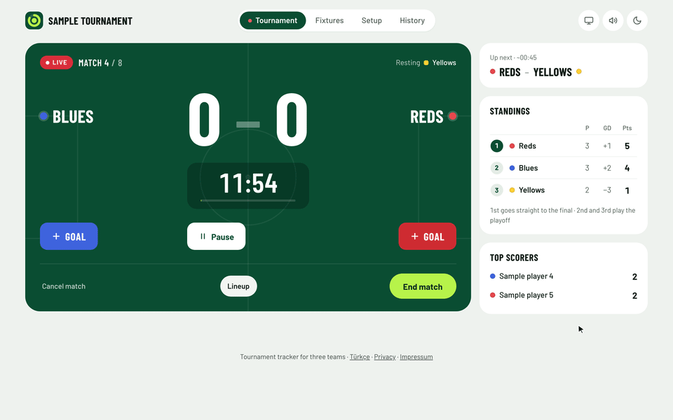

# Turfling

**A small football tournament for three teams, with the live score on every phone.**

[Website](https://hamzabasaran.com/turfling) · [Open Turfling](https://turfling.hamzabasaran.com)

<picture>
  <source media="(prefers-color-scheme: dark)" srcset="docs/images/demo-dark.gif">
  
</picture>

Turfling runs a tournament night at the pitch: three teams, a league, an optional playoff and a final. One phone keeps the clock and the score, a TV can show the big scoreboard, and everyone else follows on their own phone. It runs in the browser, needs no account and keeps working offline. The interface is in English and Turkish.

To try it, open [turfling.hamzabasaran.com](https://turfling.hamzabasaran.com) and choose **Load sample tournament**. The sample stays in your browser.

## Features

- **Players and team draw.** Pick who is playing from a permanent player pool or add new players. The draw uses pots, balances goalkeepers and avoids repeating recent teammates; it is a heuristic, not a skill rating.
- **Match clock and goals.** A countdown clock you can pause, with a beep in the last ten seconds. Goals record the scorer and the minute; own goals and unknown scorers are counted separately.
- **League, playoff and final.** Six league matches by default (two rounds), then second against third in a playoff and a final. Match lengths, rounds, changeovers and breaks are adjustable, and playoff and final can be switched off.
- **Standings, fixtures and a time plan.** Points 3/1/0, ties decided by goal difference, goals scored, head-to-head, then penalties or a coin toss. Fixtures show estimated kick-off times, and the plan warns when the tournament would run past the pitch booking.
- **TV screen.** A big scoreboard for a TV or projector, with the clock, the next match and the fixtures.
- **Live sharing.** Viewers open a link and follow the score, fixtures, standings and match summaries on their phones, with optional notifications for goals, results and the champion. The organizer can hand over to another device.
- **History.** Finished tournaments go to an archive with player totals, teammate and opponent history, and corrections.
- **Backup.** Download and import everything as one JSON file.

## Run locally

Open `index.html` directly, or serve the repository with a static HTTP server. Data stays in that browser's localStorage. Fonts are bundled and a service worker supports offline use over HTTP(S).

Use **Setup → Backup → Download** (Turkish: Kurulum → Yedek → İndir) to download a JSON backup. Backups include the current tournament, permanent player pool and every archive. Import replaces the local collection after attempting to download a backup of existing data.

## Details

- Permanent player identities, attendance selection from the player pool and new-player entry. Teams belong to individual tournaments.
- Pot-based draws compare 301 candidates, prioritising goalkeeper balance and then reducing repeated teammates. Recent tournaments carry more weight.
- Automatic match lineups with optional exceptions. Participation is counted per match, not by minutes played.
- Archives, player totals, teammate/opponent history and corrections with explicit save/cancel. Normal-time results, shootouts, own goals and unattributed goals are counted separately.
- **New tournament** (Yeni turnuva) archives a completed tournament, preserves the pool/history and clears attendance. Duplicate identities can be merged unless their match/team histories conflict. Legacy backups migrate without losing goals or identities.
- Space pauses/resumes the live clock; Escape dismisses open panels.

## Language

The interface is in English and Turkish. A language chosen with the switch in the footer is remembered in that browser. Otherwise the portfolio address (`turfling.hamzabasaran.com`) follows the browser language (Turkish for a Turkish browser, English for everything else) and every other address, including workers.dev, opens in Turkish. `?lang=en` or `?lang=tr` sets the language, for example for local testing. Push notifications are sent in the language the subscribing device used.

## Live sharing and access

In **Setup → Live sharing** (Kurulum → Canlı yayın), choose **Start live sharing** (Yayını başlat) to upload the collection. Subsequent tournaments reuse the same viewer and administrator links. Without live sharing, tournament data is local only.

**Save the administrator link using its Copy button.** The plain homepage does not identify your collection. Opening the administrator link in another browser restores the current tournament and private history. The application removes the key from the address bar after accepting it. There is no user account or lost-link recovery. Anyone holding the administrator link can edit or delete the collection.

Anonymous GET and WebSocket responses expose only the current tournament. The player pool and archives require `GET /api/t/:id/admin` with the administrator bearer key. Only one device writes at a time; others can view and explicitly take over. Revisions protect against stale offline writes.

Current-state updates do not resend archives. Library changes send only changed records; large uploads/imports use roughly 512 KiB batches. Library storage is chunked and revisions are written transactionally. The request limit is 1 MiB and the current tournament limit is 64 KiB. Old clients using the full-library protocol must refresh.

Browser storage is origin-specific. Two domains on the same Worker have separate browser caches, but **the backend is shared and an administrator key is valid on either domain**. A second hostname is not a separate security boundary.

## Deploy on Cloudflare

Requires a current Node.js version supported by Wrangler and a Cloudflare account.

```sh
cd worker
npm ci
npx wrangler dev
# After reviewing configuration:
npx wrangler deploy
```

`worker/wrangler.toml` declares static assets, the SQLite-backed `Turnuva` Durable Object and a creation rate limiter. `.assetsignore` excludes server source, tests, internal documentation and Wrangler caches. Never commit `.dev.vars`, `.wrangler`, real tournament exports or administrator links.

For a separate staging namespace:

```sh
npx wrangler deploy --name hali-saha-test
```

Links use the current origin. `turfling.hamzabasaran.com` is attached to the same Worker as a Custom Domain, next to the original workers.dev hostname, so existing browser records there remain accessible.

### Push notifications

Push is optional and stays disabled without a VAPID secret:

```sh
cd worker
node vapid-key.js | npx wrangler secret put VAPID_KEY
```

For development, place a generated VAPID JSON value in the ignored `worker/.dev.vars` file as `VAPID_KEY`. Never publish that file. On iOS, notifications require the installed home-screen application.

## Creation limits, deletion and retention

- Anonymous `POST /api/t` allows 10 creations per 60 seconds per IP and hostname at each Cloudflare location. Shared networks share that allowance. Rejection returns `429`, `rate_limited` and `Retry-After: 60`; the UI explains when to retry. Ordinary live updates are unaffected. This is location-based, not a strict global quota: [Cloudflare Rate Limiting API](https://developers.cloudflare.com/workers/runtime-apis/bindings/rate-limit/).
- Authenticated `DELETE /api/t/:id` permanently deletes the whole live collection, including archives, the pool, push subscriptions and alarms. The UI confirms the scope. Connected clients are notified; old links become unavailable. Browser copies and downloaded backups remain. Disconnecting a device is not deletion.
- Retention uses the approved 365 days after the last actual content change. Creation starts the clock for empty records. Reads, heartbeats, takeovers and identical writes do not extend it. An alarm handles expiry alongside timer/presence alarms; expired records also reject access. `RETENTION_MS` supports isolated short-duration tests.
- Legacy objects receive a full grace period when first awakened after the upgrade. Dormant objects with no alarm and no subsequent traffic require a separate inventory/migration before claiming a universal legacy cleanup deadline.

Turkish and English privacy information is in `privacy.html`, linked from both interfaces together with the operator's Impressum.

## Portfolio demo

`js/demo.js` holds the single `PORTFOLIO_HOSTS` allowlist: `turfling.hamzabasaran.com`. The demo button never appears on workers.dev, even with `?demo=1`. For localhost/127.0.0.1 preview, use `?demo=1`.

A first-time visitor on that address lands on the Tournament tab, where a card loads the sample; Setup shows the same card. It creates 15 synthetic players, three drawn teams and three completed matches locally. It refuses to replace existing players, a pool, archives, matches or a live connection. Nothing is uploaded until the visitor explicitly enables live sharing.

## Tests

```sh
node --test tests/*.test.js
cd worker
npm test
```

Worker tests use isolated, non-persistent local Workers and synthetic data. Most suites override the creation allowance so unrelated fixtures do not exhaust it; the lifecycle suite tests rate-limit rejection separately. Tests cover migration/statistics, lineups, draw balance, private access, large-library sync, conflicts, push, clocks, creation limits and deletion/expiry.

## License

Application code: [MIT](LICENSE), copyright 2026 Hamza Başaran. Bundled Barlow and Barlow Condensed fonts: SIL Open Font License 1.1, see [fonts/OFL.txt](fonts/OFL.txt).
